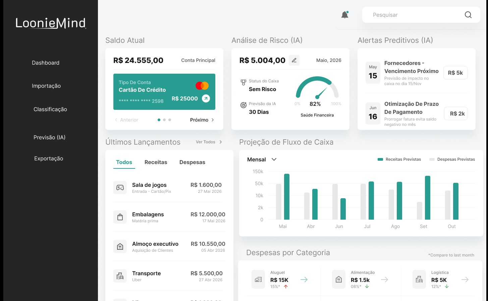
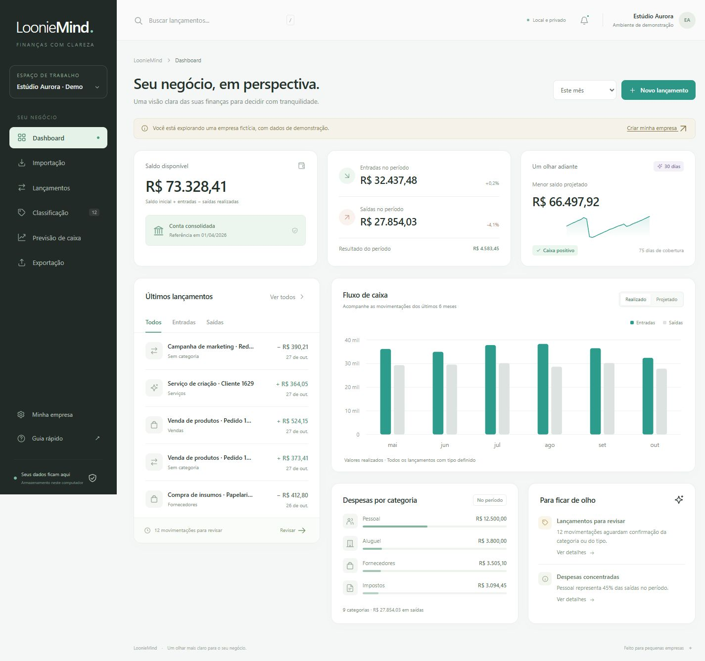
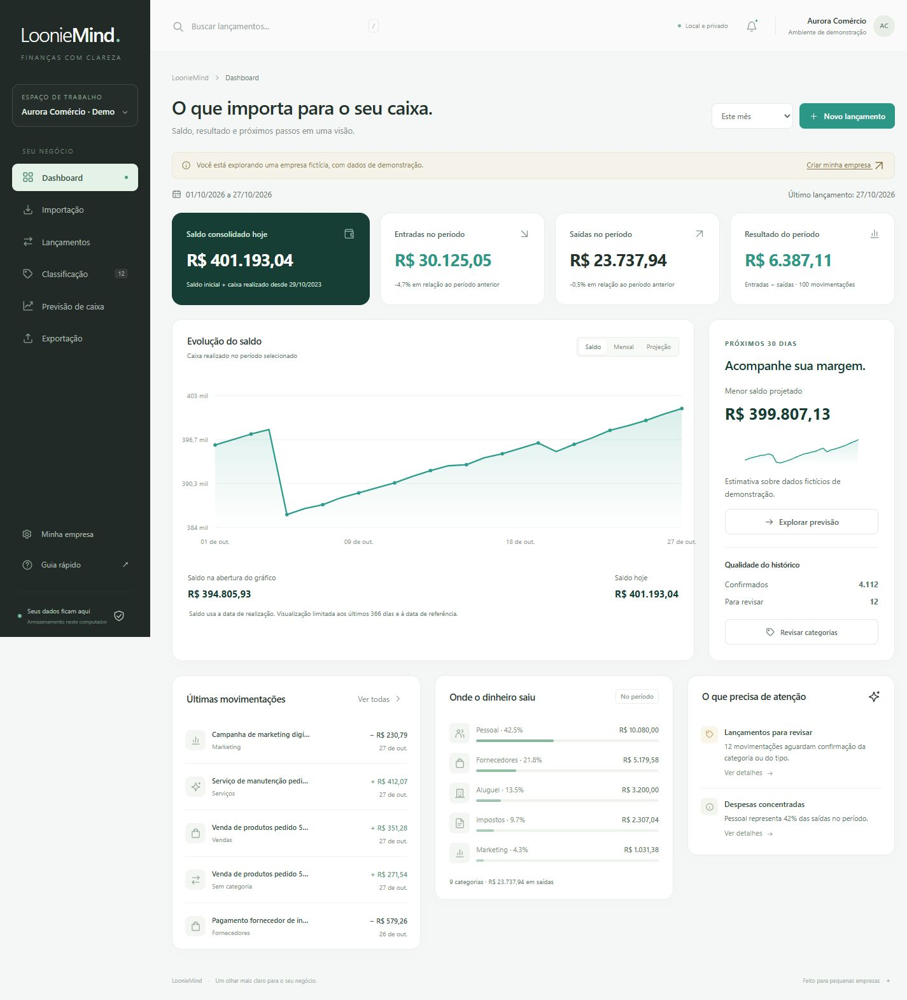

# Capítulo 1: Prototipação

> Atualizado em 03/11/2026 para refletir a versão 1.1 implementada. A proposta original (fluxo e telas previstas) foi mantida como ponto de partida; as seções abaixo registram o que foi de fato construído.

## 1. Objetivo do capítulo

Registrar como a aplicação se comporta para o usuário: fluxo de uso, telas e a evolução da interface, da referência visual até a versão 1.1.

## 2. Fluxo de uso

1. O usuário cria sua empresa (nome, saldo inicial e data de referência) ou explora uma empresa de demonstração.
2. Importa uma planilha CSV, XLS ou XLSX. O sistema mostra uma **prévia** com o mapeamento das colunas e os erros, sem gravar nada.
3. Ao confirmar, os lançamentos são gravados no histórico local, de forma transacional.
4. O modelo (ou, sem modelo, regras por palavra-chave) sugere tipo e categoria. O usuário confirma ou corrige.
5. O dashboard mostra saldo consolidado, entradas, saídas, resultado, evolução do saldo e a projeção de 30 dias.
6. A previsão estima receitas e despesas futuras para 7, 30, 60 ou 90 dias.
7. O usuário exporta lançamentos ou previsão em Excel/CSV e pode gerar um backup completo.

## 3. Telas implementadas

| Tela | Rota | Função | Status |
|---|---|---|---|
| Primeira abertura | (inicial) | Criar a própria empresa ou explorar a empresa de demonstração | Implementada |
| Dashboard | `#/dashboard` | Saldo consolidado, indicadores do período, evolução do saldo (Saldo, Mensal, Projeção), qualidade do histórico e alertas | Implementada |
| Importação | `#/import` | Envio do arquivo, mapeamento de colunas, prévia, confirmação e histórico de importações (com desfazer) | Implementada |
| Lançamentos | `#/transactions` | Busca, filtros, cadastro manual, edição e exclusão | Implementada |
| Classificação | `#/classification` | Gerar sugestões, confirmar em lote ou individualmente e treinar o modelo | Implementada |
| Previsão de caixa | `#/forecast` | Projeção de 7, 30, 60 ou 90 dias, com método e erro exibidos | Implementada |
| Exportação | `#/export` | Excel/CSV de lançamentos e previsão, backup completo e materiais do projeto | Implementada |
| Minha empresa | `#/settings` | Empresas, saldo de referência, categorias, base ampliada de demonstração e histórico de alterações | Implementada |

## 4. Protótipos e evolução da interface

Não foi usada uma ferramenta de prototipação separada: a interface partiu de uma imagem de referência enviada pelo responsável e foi implementada diretamente em HTML, CSS e JavaScript (capítulo 4).

**Referência visual original**

**Dashboard da versão 1**

**Dashboard da versão 1.1** (saldo consolidado separado do resultado do período)

Capturas adicionais da entrega e da apresentação da v1.1: [entrega](dashboard-entrega-v1.1.jpg) e [apresentação](dashboard-apresentacao-v1.1.jpg).

## 5. Adaptações em relação à referência

- **Mantidos:** menu lateral escuro, identidade LoonieMind, cores verde/teal, fundo claro, cartões financeiros, lançamentos e gráficos.
- **Acrescentados:** seleção de empresa, indicador de armazenamento local, primeira abertura guiada, identificação dos dados de demonstração, filtros, busca, edição e menu para telas pequenas.
- **Substituídos:** o cartão de crédito da referência virou **conta consolidada e saldo de referência**, pois não há integração bancária. O índice de "saúde financeira" foi trocado por saldo mínimo projetado e dias de cobertura calculados. Alertas de vencimento viraram avisos baseados no histórico (revisões pendentes, concentração de despesas, histórico insuficiente e possível saldo negativo).
- **Realizado × projetado:** o gráfico separa o que é histórico do que é estimativa.

O registro completo das decisões está em [Decisões e escopo](../DECISOES-E-ESCOPO.md).

## 6. Pontos em aberto

- Validar as telas e a rotina de importação com o responsável financeiro de uma empresa real.
- Não há tela de contas a pagar/receber com vencimentos individuais; a previsão é estatística e não lê agenda de pagamentos.
- Não há registro de revisão de acessibilidade; a interface tem apenas atalhos de teclado básicos (`/` foca a busca; `Esc` fecha menu e alertas).

[Voltar ao índice](../../README.md)
