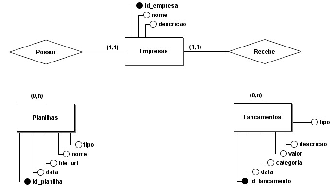
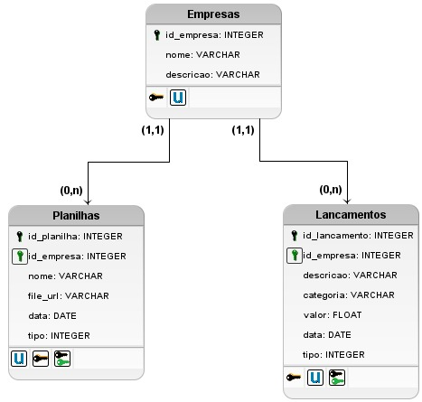

# Capítulo 2: Modelagem do banco de dados

> Atualizado em 03/11/2026. Os diagramas abaixo são o modelo original e foram preservados como referência histórica. A aplicação usa um banco operacional separado (esquema v2, descrito na seção 5), que amplia o modelo original. O arquivo original, agora em `plataforma/database/LoonieMind.db`, continua vazio e inalterado.

## 1. Objetivo do capítulo

Documentar o modelo de dados usado para armazenar o histórico localmente em SQLite: primeiro o modelo original (conceitual e lógico) e depois o esquema operacional implementado.

## 2. Modelo conceitual (original)

## 3. Modelo lógico (original)

## 4. Relacionamentos (original)

Uma empresa possui várias planilhas e recebe vários lançamentos.

| Entidade | Cardinalidade | Relacionamento | Entidade | Cardinalidade |
|---|---|---|---|---|
| Empresas | (1,1) | Possui | Planilhas | (0,n) |
| Empresas | (1,1) | Recebe | Lancamentos | (0,n) |

## 5. Esquema operacional (v2)

O banco operacional fica em `data/looniemind.sqlite3` (pasta configurável por `LOONIEMIND_DATA_DIR`) e não é versionado no Git. O esquema é criado de forma idempotente em `looniemind/db.py`, registrado em `schema_migrations` e identificado por `PRAGMA user_version = 2`. As chaves estrangeiras ficam ativas em toda conexão.

Legenda da coluna Chave: PK é chave primária e FK é chave estrangeira.

### Tabelas

| Tabela | Função |
|---|---|
| Empresas | Cada negócio acompanhado; todas as demais tabelas dependem dela |
| Categorias | Categorias de receita e despesa de cada empresa |
| Planilhas | Cada arquivo importado, com estado da importação |
| Lancamentos | Cada movimentação financeira; tabela principal |
| Auditoria | Registro das ações (importações, revisões, exclusões, treinos) |
| schema_migrations | Versões do esquema já aplicadas |

### Empresas

| Campo | Tipo | Chave | Para que serve |
|---|---|---|---|
| id_empresa | INTEGER | PK | Identificador da empresa |
| nome | TEXT | | Nome exibido na interface e nos arquivos exportados |
| descricao | TEXT | | Texto livre sobre a empresa |
| saldo_inicial_centavos | INTEGER | | Saldo existente antes das movimentações da data de referência |
| data_saldo | TEXT | | Data de referência do saldo inicial (ISO, AAAA-MM-DD) |
| demo | INTEGER | | 1 para empresa de demonstração sintética |
| revisao | INTEGER | | Contador incrementado a cada alteração; invalida a previsão em cache |
| created_at, updated_at | TEXT | | Datas de criação e atualização (UTC) |

### Categorias

| Campo | Tipo | Chave | Para que serve |
|---|---|---|---|
| id_categoria | INTEGER | PK | Identificador |
| id_empresa | INTEGER | FK para Empresas | Dono da categoria |
| nome | TEXT | | Nome da categoria |
| tipo | INTEGER | | 1 = receita, 2 = despesa. O trio empresa/nome/tipo é único |

Categorias padrão: receitas (Vendas, Serviços, Outras receitas) e despesas (Fornecedores, Aluguel, Pessoal, Impostos, Marketing, Logística, Alimentação, Utilidades, Outras despesas).

### Planilhas

| Campo | Tipo | Chave | Para que serve |
|---|---|---|---|
| id_planilha | TEXT | PK | UUID interno do arquivo |
| id_empresa | INTEGER | FK para Empresas | Empresa que recebeu o arquivo |
| nome | TEXT | | Nome original do arquivo |
| file_url | TEXT | | Caminho interno onde o original é guardado (sob UUID, nunca sob caminho informado pelo usuário) |
| sha256 | TEXT | | Hash do conteúdo, usado para impedir reimportação |
| aba | TEXT | | Aba importada (vazio em CSV) |
| opcoes | TEXT | | Opções de mapeamento e normalização, em JSON |
| status | TEXT | | `preview`, `confirmed` ou `undone` |
| total_linhas, importados, rejeitados | INTEGER | | Contagens da importação |
| created_at, updated_at | TEXT | | Datas (UTC) |

Um índice único parcial impede duas importações **confirmadas** da mesma empresa, arquivo (hash) e aba.

### Lancamentos

| Campo | Tipo | Chave | Para que serve |
|---|---|---|---|
| id_lancamento | INTEGER | PK | Identificador |
| id_empresa | INTEGER | FK para Empresas | Dono do lançamento |
| id_planilha, linha_origem | TEXT, INTEGER | FK para Planilhas | Origem quando veio de importação; o par é único |
| descricao | TEXT | | Descrição como veio na planilha; é a única entrada do classificador |
| categoria | TEXT | | Categoria em texto (veja a observação abaixo). Padrão: "Sem categoria" |
| valor_centavos | INTEGER | | Valor em centavos, sempre inteiro e positivo |
| data | TEXT | | Data realizada (ISO, AAAA-MM-DD) |
| tipo | INTEGER | | 1 = receita, 2 = despesa, vazio = pendente (fica fora dos totais) |
| revisado | INTEGER | | 1 quando uma pessoa confirmou ou corrigiu |
| origem, sugestao, original | TEXT | | Como o lançamento entrou, sugestão do sistema e dados originais antes de correções |
| documento, contraparte, centro_custo, conta, forma_pagamento, competencia, observacoes, id_externo | TEXT | | Os oito campos complementares acrescentados no esquema v2 |
| created_at, updated_at | TEXT | | Datas (UTC) |

### Auditoria

| Campo | Tipo | Chave | Para que serve |
|---|---|---|---|
| id | INTEGER | PK | Identificador |
| id_empresa | INTEGER | FK para Empresas | Empresa afetada |
| acao, entidade, referencia | TEXT | | O que foi feito e sobre qual registro |
| detalhes | TEXT | | Detalhes estruturados em JSON (inclui dados anteriores em correções) |
| created_at | TEXT | | Data da ação (UTC) |

### Observação: categoria em texto no banco e em número no modelo

O campo `categoria` continua sendo texto (VARCHAR no modelo original, TEXT no SQLite), como decidido pelo grupo. O classificador trabalha internamente com códigos numéricos de classe, mas esses códigos pertencem ao artefato do modelo: são codificados e decodificados lá dentro, e o banco guarda sempre o **nome** da categoria. Assim não há mistura de nomes e códigos no mesmo campo, o que prejudicaria o agrupamento nos gráficos.

### Tabela de códigos: tipo de lançamento (Lancamentos.tipo e Categorias.tipo)

| Código | Tipo | Efeito no caixa | Exemplo |
|---|---|---|---|
| 1 | Receita | Entrada: aumenta o saldo | Venda de produtos |
| 2 | Despesa | Saída: diminui o saldo | Pagamento de fornecedor |
| vazio (NULL) | Pendente | Fica fora de receitas, despesas e saldo até a revisão | Valor positivo sem tipo informado |

Regras de uso:

- O valor é sempre positivo; quem define se entra ou sai do caixa é o tipo.
- Saldo atual = saldo inicial + receitas − despesas realizadas desde a data de referência, inclusive.
- Para aceitar um novo tipo, acrescente um código no fim da tabela sem alterar os existentes.

## 6. Mudanças em relação ao modelo original

| Item | Modelo original | Esquema operacional v2 |
|---|---|---|
| Valor | `valor` FLOAT, em reais | `valor_centavos` INTEGER, evitando erros de ponto flutuante |
| Datas | DATE | TEXT em formato ISO; timestamps de auditoria em UTC |
| Formato do arquivo | `Planilhas.tipo` com código 1 (CSV), 2 (XLS), 3 (XLSX) | Coluna não implementada; o formato é identificado pela extensão na leitura do arquivo |
| Data de importação | `Planilhas.data` | `created_at` e `updated_at` |
| Saldo | Não previsto | `saldo_inicial_centavos` e `data_saldo` em Empresas |
| Revisão humana | Não prevista | `revisado`, `sugestao`, `original` em Lancamentos |
| Auditoria e categorias | Não previstas | Tabelas Auditoria e Categorias |
| Dados complementares | Não previstos | Oito campos adicionados na migração v1 para v2 |

## 7. Migração e backup

- Bancos v1 recebem os campos complementares na abertura; antes disso é feita uma cópia em `data/backups/antes-da-versao-2.sqlite3`.
- O backup completo (ZIP) inclui todas as empresas, o banco e os arquivos originais; **não** inclui os modelos treinados, que devem ser treinados novamente após a restauração.
- A restauração aceita backups v1 e v2, grava em uma pasta nova e não executa SQL vindo do arquivo recebido.

Detalhes e justificativas: [Arquitetura operacional](../ARQUITETURA.md).

## 8. Pontos em aberto

- Não há suporte a contas individuais com saldo inicial próprio, parcelas ou vencimentos futuros.
- O `ID externo` não é chave de deduplicação automática.

[Voltar ao índice](../../README.md)
