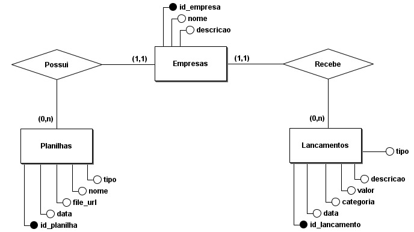
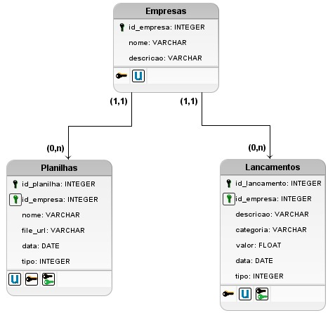

# Capítulo 2: Modelagem do banco de dados

Projeto: LoonieMind
Status: em andamento
Responsável: (nome)

## 1. Objetivo do capítulo

Documentar o modelo de dados usado para armazenar o histórico localmente em SQLite.

## 2. Diagramas

Modelo conceitual:

Modelo lógico:

## 3. Relacionamentos

Uma empresa possui várias planilhas e recebe vários lançamentos.

| Entidade | Cardinalidade | Relacionamento | Entidade | Cardinalidade |
|---|---|---|---|---|
| Empresas | (1,1) | Possui | Planilhas | (0,n) |
| Empresas | (1,1) | Recebe | Lancamentos | (0,n) |

## 4. Tabelas

### Empresas

| Campo | Tipo | Observação |
|---|---|---|
| id_empresa | INTEGER | Chave primária |
| nome | VARCHAR | |
| descricao | VARCHAR | |

### Planilhas

| Campo | Tipo | Observação |
|---|---|---|
| id_planilha | INTEGER | Chave primária |
| id_empresa | INTEGER | Chave estrangeira para Empresas |
| nome | VARCHAR | |
| file_url | VARCHAR | Local do arquivo importado |
| data | DATE | |
| tipo | INTEGER | |

### Lancamentos

| Campo | Tipo | Observação |
|---|---|---|
| id_lancamento | INTEGER | Chave primária |
| id_empresa | INTEGER | Chave estrangeira para Empresas |
| descricao | VARCHAR | |
| categoria | VARCHAR | |
| valor | FLOAT | |
| data | DATE | |
| tipo | INTEGER | |

[Voltar ao índice](../../README.md)
